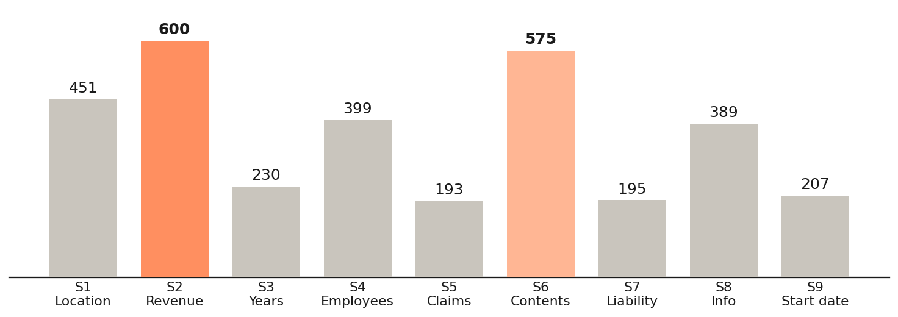
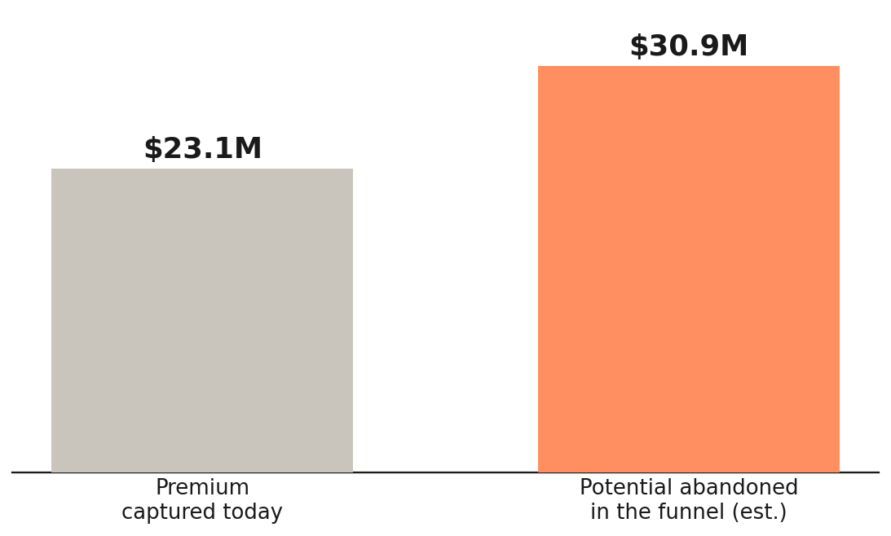

# The Revenue Question: Supernova Quote Funnel Analysis

A funnel analysis of a small-business **insurance quote flow**, built during the
Supernova BIA Externship (TripleTen, June 2026). It answers the question every
digital insurer eventually asks: *why do 1 in 3 applicants quit before they ever
see a price, and what is that leak worth?*

The headline finding: **one question does the most damage.** The Annual Revenue
question is both the biggest friction point in the form *and* the eligibility
gate. Asking it to do both jobs at once is the single largest leak in the funnel.

📊 **Final deliverable:** [`presentation/The_Revenue_Question_Supernova_Final.pptx`](presentation/The_Revenue_Question_Supernova_Final.pptx)

---

## The Business Question

Supernova sells small-business insurance through a nine-stage online quote form.
Every abandoned form is premium that walks away silently: no decline letter, no
signal, just a session that ends. The question isn't *"how many people finish?"*
It's *"which stage kills the most quotes, why, and what would recovering it be
worth?"* This analysis walks the funnel stage by stage to tell friction problems
apart from eligibility problems and technical failures, because each one has a
different fix.

---

## About the Externship

The Supernova BIA Externship (via TripleTen, June 2026) simulates the day-to-day
of a business intelligence analyst at a digital insurance underwriter. The work
was structured as **120 numbered business questions across three topics**, each
answered with an Excel pivot table plus a short "why it matters" note, followed
by a finals phase where I chose one storyline, sized it in dollars, and defended
it in a timed final presentation to the program.

The same 9,817-quote dataset was examined through three different lenses:

1. **Topic 1, Premium (the revenue lens, Q1 to 40):** how much money is in this
   book, and what drives it?
2. **Topic 2, Rejections (the underwriting lens, Q41 to 80):** who gets declined,
   and why?
3. **Topic 3, The quote journey (the conversion lens, Q81 to 120):** where do
   applicants leave, and what does it cost?

The final presentation is built on Topic 3, with the dollar figures from
Topic 1 and the decision logic from Topic 2 supporting it.

---

## Dataset

**9,817 insurance quote attempts**, one row per quote, provided by the externship
program. Each record carries the stage where an incomplete quote stopped
(`incomplete_stage`), the source app, state, industry code and category, the
underwriting decision and its free-text `rejection_log`, address-verification
artifacts (Google Place ID / map link), and a per-coverage premium breakdown
(Building, Contents, Flood, Earthquake, Crime, General Liability, Business
Interruption, EBI, and more).

Each workbook follows an `original data` → `clean data` pipeline plus pivot
tables:

| File | Contents |
|---|---|
| `data/topic1_premium_analysis.xlsx` | Data cleaning + premium breakdown by category, industry, and source app (Q1 to 40) |
| `data/topic2_rejections_fus.xlsx` | Rejection rates by category and FUS grade distribution (Q41 to 80) |
| `data/topic3_funnel_dropoff.xlsx` | Stage-by-stage funnel drop-off analysis (Q81 to 120) |
| `data/finals_revenue_leak.xlsx` | Final EDA: sizing the revenue leak behind the presentation |

**Feature engineering.** The raw rejection log is free text, so a real part of
the work was parsing it into countable columns with text formulas (`MID`,
`FIND`, `SEARCH`, `IFERROR`): the FUS fire-protection grade (`Extracted_FUS`),
underwriting rule IDs (`Extracted_Rule`), alert flags (hazardous materials,
cranes/heavy equipment, alcohol), the revenue figure that triggered the $2M cap
(`Revenue Band`), a has-Place-ID flag, and per-email roll-ups to study repeat
applicants. One engineered column (`Email_Domain`) turned out to be a dead end,
since emails are hashed, and that is documented in the workbook rather than
hidden.

**Known limits, named up front:** Ontario is about 90% of rows, so province
comparisons outside it aren't statistically meaningful; about 1,200 rows are
missing a category (mostly clustered in the never-priced cohort); and the data
is a training/synthetic set, so patterns are directional, not gospel.

---

## The Three Topics

### Topic 1, Premium: sizing the book

Total premium across the dataset is **$23.08M**, spread over 2,419 priced
quotes averaging **$9,541** each (median $9,665, so pricing is symmetric, not
dragged by whales). B&P Services is the cash-cow category by volume; the
spread in average premium across categories is small (about $1,900), and the
top 10% of accounts start at $13,928. Scenario questions put numbers on levers:
a +5% General Liability rate change is worth about $361K, and dropping Flood
entirely would cost about $276K. The most important derived metric: **revenue
per risk is $2,351**, total premium divided by all 9,817 attempts, not just the
priced ones. That gap between $9,541 per priced quote and $2,351 per lead *is*
the funnel problem, stated as money.

### Topic 2, Rejections: how underwriting says no

Of the 5,492 quotes that reached a decision, **50.4% were rejected**. Parsing
the rejection log showed the machinery: a **FUS fire-protection grade of 10
(the worst) is an automatic decline** (all 749 such quotes were rejected), and
every alert flag (hazardous materials, heavy equipment, alcohol) is a hard
stop, not a warning. An integrity check confirmed zero rejections with no
logged reason. One subtle finding set up the finals: quotes without a verified
address get rejected more often (56% vs 50%), but "fixing" that recovers $0
of modeled revenue. The missing address is a symptom, and the real damage it
does shows up in Topic 3.

### Topic 3, The quote journey: where the money walks away

Completion rate is **67%**: 3,239 of 9,817 applicants abandon mid-form, and
the drop-off chart below shows exactly where. Just as important were the
controls that *ruled out* easy explanations: verified-address applicants don't
complete at a higher rate, no industry segment quits disproportionately, and
cosmetic fixes are small (auto-filling the address recovers only about 22
quotes). The leak is structural. It's the form itself.

This topic also surfaced the "zombie" cohort: **1,086 quotes that complete the
form but are never priced** (no decision and no premium). 941 of them have no
Place ID or map link, which points to an address-lookup failure rather than an
underwriting decline. Repeat applicants told the same story from another angle:
129 emails tried more than once, covering 1,305 quotes, and those repeat
attempts complete at only about 35%, a signal of frustration, not persistence.

### Finals: choosing and defending one story

The finals phase forced a choice: three defensible storylines, one
presentation. I chose the funnel story because it passes the
what / why / so-what test cleanly (Stage 2 is the biggest leak; it's a
sensitive money question asked too early; the expected value of the leak is
about $11.4M), and because its recommendation, reorder the form and fix a
lookup, is concrete and low-risk, unlike Topic 2's natural recommendation of
accepting worse fire risk. The deck was built for a six-minute executive read:
one claim per slide, every rate stated with its denominator.

---

## The Funnel

Nine stages, in order: **S1 Location → S2 Revenue → S3 Years in business →
S4 Employees → S5 Claims history → S6 Contents → S7 Liability → S8 Info →
S9 Start date.** Only 67% of attempts (6,578) finish all nine stages; 3,239
quotes (33%) abandon somewhere along the way. Finishing the form is not the
same as getting a price: of the 6,578 who finish, 2,419 come back priced.

---

## Key Findings

- **The Annual Revenue question (S2) is the single biggest leak.** 600
  applicants quit there, more than at any other stage. It is the first
  sensitive money question in the form, and it arrives at stage two of nine.
- **The same question is also the eligibility gate.** Supernova declines firms
  over $2M in revenue, but only at the very end. The $2M rule shows up in 2,293
  rejection logs (83% of all rejections), and **about 35% of everyone who
  completes the form hits it.** In most of those logs it fires alongside other
  rules (2,027 also carry a fire-protection grade, 687 of them the automatic
  grade 10), and only 19 rejections list revenue as the only rule; most of the
  rest also carry a fire-protection grade or an industry-code decline. So the cap
  is not the sole cause of most rejections, but it is applied to a third of all
  finishers, silently, after they have done all the work. Reducing friction
  means asking revenue later; filtering ineligible firms means asking it first.
  One question cannot do both.
- **Even finishing isn't safety:** 1,086 completed quotes generate $0 premium
  and carry no decision. Most have no verified address or map link. The form
  completes; pricing never runs. At the 44% priced rate of quotes that do reach
  a decision, that cohort is worth an estimated **$4.6M in expected premium**,
  and up to $10.4M if every one of them priced.
- **The leak is about half the size of the book.** If the 3,239 abandoned
  quotes had finished and converted at the same 36.8% priced rate as everyone
  else who finished, they would be worth an estimated **$11.4M in expected
  premium**, against the **$23.1M captured today**. The upper bound, if every
  abandoned quote priced, is $30.9M. Either way the funnel is the single biggest
  lever in the data: the next largest levers from Topic 1 are worth a few
  hundred thousand dollars each.

---

## Visuals

### Drop-offs by Funnel Stage

Each bar is the number of applicants who quit at that stage of the nine-step
form. The two highlighted stages are the story: **S2 Revenue (600 drop-offs)**
is the single worst stage. It's the first sensitive money question, and it
arrives before the applicant has invested much in the form. **S6 Contents
(575)** is a close second, where the form shifts from basic facts about the
business to detailed coverage questions. Notice the pattern around them:
drop-off falls once applicants get past S2 (they've committed), then spikes
again when the effort level jumps at S6. The easy stages in between (Years,
Claims, Liability) each lose only about 200.

### Premium Captured vs Abandoned in the Funnel

This chart sizes the leak in dollars at its upper bound. The left bar is the
premium the book actually captures today ($23.1M): every quote that finished
the form and got priced. The right bar is the potential premium sitting in the
3,239 abandoned quotes ($30.9M) if every one of them had priced at the average
premium of comparable completed quotes. In practice only 36.8% of finishers get
priced, so the expected value of the leak is about $11.4M, roughly half the
existing book. Even at that discount, a modest recovery rate on funnel
drop-offs would move revenue more than any other lever in the data.

---

## Recommendations

1. **Split the revenue question.** Add a quick eligibility gate up front to
   filter the >$2M firms early; keep the detailed revenue question where rating
   actually needs it.
2. **Fix the address lookup.** Require a verified address (Place ID) at Stage 1
   so pricing always runs, recovering an expected $4.6M (up to $10.4M) in
   completed-but-unpriced quotes.
3. **Re-test and measure.** A/B the new flow; track completion rate and
   priced-quote rate before rollout.

---

## Skills Demonstrated

- **Excel analysis at scale:** original → clean data pipelines, pivot tables,
  and lookup logic across four workbooks and 120 business questions.
- **Feature engineering from messy text:** parsing FUS grades, rule IDs, alert
  flags, and the revenue figure out of a free-text rejection log so they could
  be counted.
- **Denominator discipline:** every rate in the analysis names its base
  (all 9,817 attempts vs 6,578 completions vs 5,492 decisioned quotes),
  because that's where funnel analyses quietly go wrong.
- **Ruling things out:** using control comparisons (address verification,
  segment mix, cosmetic fixes) to show the leak is structural, not
  demographic.
- **Sizing findings in dollars, with an expected value and an upper bound:**
  translating drop-off counts into revenue estimates an executive can rank
  ($11.4M expected and $30.9M upper bound for the funnel; $4.6M expected and
  $10.4M upper bound for the unpriced cohort).
- **Executive storytelling:** choosing one storyline out of three defensible
  ones and defending it in a timed presentation.

---

## Notes

- **Tools:** Excel (data cleaning, pivot tables, funnel analysis), PowerPoint.
- The dataset was provided by the externship program for training purposes and
  reflects a simulated/anonymized book of business, not live production data.
- **How the dollar figures are built.** Every quote is valued at the average
  premium of a priced quote ($9,541). Upper bounds assume every quote in the
  cohort would have priced. Expected values discount by the observed priced
  rate for that cohort: 36.8% for abandoned quotes (2,419 priced ÷ 6,578
  finishers, since a recovered quote still has to clear underwriting) and 44.0%
  for the never-priced cohort (2,419 ÷ 5,492 decisioned, since these quotes had
  already finished the form). All figures are estimates and are labeled as such.
- **Revision, September 2026.** An earlier version of this README reported only
  the upper-bound figures ($30.9M and $10.4M). This version adds the expected
  values and corrects two descriptions: the $2M cap appears in 83% of rejection
  logs but is rarely the only rule that fired, and 1,305 is the number of quotes
  from repeat emails, not the number of emails.
- **Revision, October 2026.** A recount from the raw rejection logs corrected
  three figures. 71 logs carry two fire-protection grades and the extraction
  formula read only the first, so grade-10 quotes are 749 (not 743) and grade 10
  plus the $2M rule is 687 (not 681). Revenue is the only logged rule in 19
  rejections; the earlier 214 counted rejections with no fire-protection grade,
  underwriting rule or alert, but most of those carry an industry-code decline.
